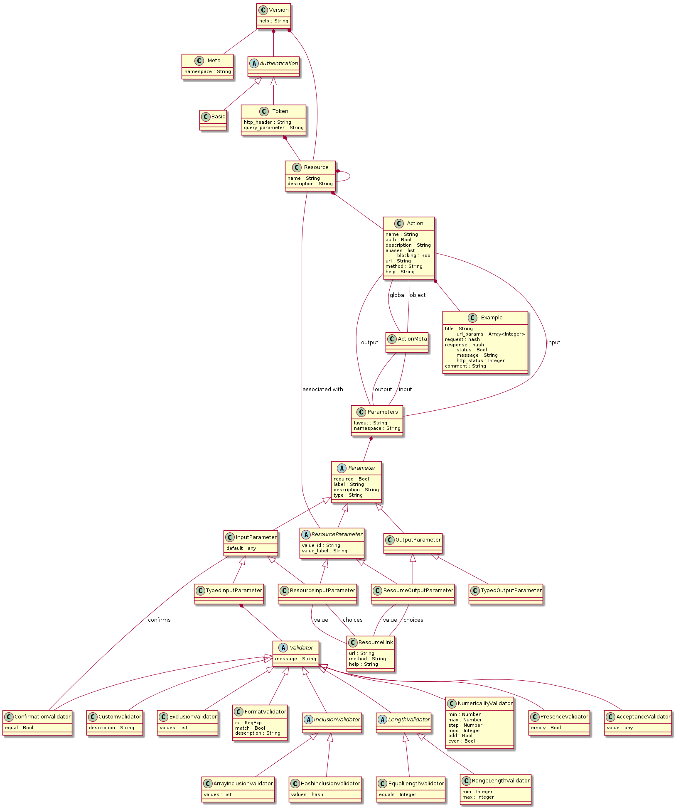

<h1 id="protocol-definition">Definice protokolu</h1>

HaveAPI definuje formát popisu API a URL, na kterých je tento popis dostupný.

<h1 id="self-description">Popis API</h1>

API samo poskytuje svůj popis, který klienti používají pro práci s ním.
Popis obsahuje přístupové URL, HTTP metody, vstupní a výstupní parametry
včetně jejich validátorů. Součástí jsou i příklady použití a textové poznámky.

Na požadavek ``OPTIONS /`` vrací API popis celého API včetně všech jeho verzí.
Popis konkrétní verze získáš například pomocí ``OPTIONS /v1/``.

Na HTTP metodu ``OPTIONS`` odpovídá i každá akce a vrací svůj popis.
Akce se stejnou URL rozlišíš parametrem ``?method=HTTP_METHOD``.

Změny API se tak okamžitě projeví ve všech klientech bez úpravy jediného řádku
jejich kódu. Stejný klient může beze změn pracovat se všemi API, která mají
kompatibilní formát popisu.

<h1 id="protocol-versioning">Verzování protokolu</h1>

Verze protokolu určuje podobu a obsah:

 - obálky odpovědi,
 - popisu API,
 - přenášených dat.

Verze protokolu má tvar `<major>.<minor>`. `major` se zvyšuje při změně,
která narušuje zpětnou kompatibilitu. Pokud změna zachovává zpětnou
kompatibilitu a pouze přidává nové funkce, `major` zůstává a zvyšuje se `minor`.

<h1 id="envelope">Obálka</h1>

Každá odpověď API je kromě níže uvedeného výstupního formátu zabalena do obálky.
Obálka oznamuje úspěch či selhání akce a poskytuje návratovou hodnotu nebo
chybové zprávy.

      {
          "status": true if action succeeded or false if error occured,
          "response": return value,
          "message": error message, if status is false,
          "errors: {
              "parameter1": ["list", "of", "errors"],
              "parameter2": ["and", "so", "on"]
          }
      }

Odpovědi na požadavky `OPTIONS` obsahují v obálce také verzi protokolu:

    "version": <version>

<h2 id="localization">Lokalizace</h2>

Servery mohou pomocí HTTP hlavičky `Accept-Language` překládat řetězce určené
uživatelům. Lokalizace mění pouze řetězcové hodnoty, například `message`,
položky parametrů v `errors` a zprávy validátorů v popisu API. Přeložené mohou
být také hodnoty `label` a `description` parametrů v popisu API. Struktura
obálky zůstává stejná a klienti musí tyto hodnoty nadále zpracovávat jako řetězce.

<h1 id="description-format">Formát popisu</h1>

V tomto dokumentu je popis API zapsaný v JSON. Může ale používat kterýkoli
z podporovaných výstupních formátů.

<h2 id="api-version">Verze API</h2>

Verze API je popsána takto:

    {
        "authentication": {
            ... authentication methods ...
        },
        "resources": {
            ... resources ...
        },
        "meta": {
            "namespace": "_meta"
        },
        "help": "/<version>/"
    }

Podrobnosti k jednotlivým částem najdeš v příslušných oddílech.

<h2 id="authentication">Autentizace</h2>

HaveAPI definuje rozhraní pro vlastní autentizační metody. Vestavěná je HTTP
Basic autentizace a autentizace tokenem.

Autentizační metody lze nastavit pro každou verzi API. Jsou součástí popisu
API, ale klient jim musí rozumět. Z dostupných metod si může vybrat tu,
kterou upřednostňuje.

<h3 id="http-basic-authentication">HTTP Basic autentizace</h3>

HTTP Basic autentizace nepotřebuje další konfiguraci; popis pouze oznamuje
její dostupnost.

    "basic": {}

HTTP Basic autentizace nepodporuje vícefaktorovou autentizaci.

<h3 id="token-authentication">Autentizace tokenem</h3>

Autentizace tokenem obsahuje zdroj ``token``, který slouží k získávání a rušení tokenů.

Tokeny se získávají akcí ``request``, ve které klient předá přihlašovací údaje
podle požadavků API. Pokud jsou správné, server buď autentizaci dokončí, nebo
vyžádá další autentizační kroky.

Při jednokrokové autentizaci vrátí akce ``request`` token a dobu jeho platnosti.
Pokud jsou potřeba další kroky, server to oznámí hodnotou ``complete = true``.
Klient pak musí zavolat další krok, tedy akci na zdroji ``token`` uvedenou
v ``next_action``.

Token se vrací v obou případech. Po dokončení autentizace slouží k ověřování
dalších požadavků. Pokud autentizace pokračuje, slouží k ověření následujícího
autentizačního požadavku, který vrátí další token.

Po dokončení autentizace lze získané tokeny obnovovat akcí ``renew`` a rušit
akcí ``revoke``.

    "token": {
        "http_header": "<name of HTTP header to transfer token in, by default X-HaveAPI-Auth-Token>",
        "query_parameter": "<name of query parameter for token, by default auth_token>",
        "resources": {
            "actions": {
                "request": {
                    ...
                    "input": {
                        ...
                        "parameters": {
                            "user": ...
                            "password": ...
                            "lifetime": ...
                            "interval": ...
                        },
                        ...
                    },
                    "output": {
                        ...
                        "parameters": {
                            "token": ...
                            "valid_to": ...
			    "complete": true/false
			    "next_action": ...
                        },
                        ...
                    },
                    ...
                 }
                "revoke": ...
            }
        }
    }

Formát části ``resources`` je stejný jako u ostatních zdrojů.

<h2 id="resources">Zdroje</h2>

Každý zdroj je popsán takto:

    "<resource_name>": {
        "description": "Some description that explains everything",
        "actions": {
            ... actions ...
        },
        "resources": {
            ... nested resources ...
        }
    }

<h2 id="actions">Akce</h2>

Každá akce je popsána takto:

    "<action_name>": {
        "auth": true|false,
        "description": "Describe what this action does",
        "aliases": ["list", "of", "aliases"],
        "blocking": true|false,
        "input":  {
            "layout": "layout type",
            "namespace": "namespace name",
            "parameters": {
                ... parameters ...
            }
        },
        "output": {
             "layout": "layout type",
             "namespace": "namespace name",
             "parameters": {
                  ... parameters ...
              }
        },
        "examples": [
            ... list of examples ...
        ],
	"meta": ... metadata ...,
        "path": "Path for this action",
        "method": "HTTP method to be used",
        "help": "Path to get this very description of the action"
    }

<h3 id="layouts">Rozložení</h3>

Rozložení je určeno pro vstupní a výstupní parametry. Klienti podle něj vědí,
jak odeslat požadavek a jak interpretovat odpověď.

Definovaná rozložení:

 - object – zejména odpověď se má zpracovat jako instance zdroje
 - object_list – seznam objektů
 - hash – hash parametrů, se kterým se má pracovat jako s hashem
 - hash_list – seznam hashů

V klientských knihovnách výstup s rozložením ``object`` obvykle vrací objekt
představující instanci zdroje. Parametry jsou dostupné jako vlastnosti objektu
nebo obdobným způsobem.

<h3 id="namespace">Jmenný prostor</h3>

Všechny vstupní a výstupní parametry patří do jmenného prostoru, kterým je
obvykle název zdroje.

Například:

    {
        "user": {
            ... parameters ...
        }
    }

<h2 id="parameters">Parametry</h2>

Existují dva druhy parametrů.

<h3 id="data-types">Datové typy</h3>

Typ může být jeden z následujících:

 - String
 - Text
 - Boolean
 - Integer
 - Float
 - Datetime

<h4 id="typed-input-coercion-and-validation">Převod a validace typovaných vstupů</h4>

Servery i klienti MUSÍ typované vstupní parametry přísně validovat. Parametry
query stringu přicházejí jako řetězce a před validací se musí zpracovat.
Jednotná pravidla a příklady uvádí [Validace typovaných vstupů](typed-input-validation.md).
Explicitní `null` je povolené pouze u parametrů označených jako `nullable`
(obvykle nepovinných) a klienti ho MUSÍ zachovat a odeslat jako JSON `null`.
Server tak rozliší vynechanou hodnotu od výslovně vymazané. V query stringu
se explicitní `null` zapisuje jako prázdný řetězec. Server považuje prázdný
řetězec nebo bílé znaky za `null` pouze u typovaných parametrů s `nullable`.
U ostatních parametrů se prázdné řetězce validují běžným způsobem:
String/Text je mohou přijmout, ostatní typy je odmítají.

Příklad (query string, nepovinný typovaný parametr nastavený na `null`):

    GET /resource/action?resource[dt]=

        "<parameter_name>": {
            "required": true/false/null,
            "nullable": true/false,
            "label": "Label for this parameter",
            "description": "Describe it's meaning",
            "type": "<one of the data types>",
            "validators": ... validators ...,
            "default": "default value that is used if the parameter is omitted",
            "protected": true/false
        }

<h4 id="validators">Validátory</h4>

Každý parametr má vlastní validátory. Může obsahovat kterýkoli z následujících.
Aby byla vstupní hodnota platná, musí projít všemi svými validátory.

<h5 id="acceptance">Předepsaná hodnota</h5>

Používá se, když parametr musí mít jednu konkrétní hodnotu.

    "accept": {
        "value": <value to accept>,
        "message": "has to be <value>"
    }

<h5 id="presence">Přítomnost</h5>

Parametr musí být přítomný. Pokud je `empty` nastaveno na `false`, před
kontrolou se odstraní bílé znaky na začátku a na konci hodnoty.

    "present": {
        empty: true/false,
        message: "must be present"
    }

<h5 id="confirmation">Potvrzení</h5>

Ověřuje, zda mají dva parametry stejnou, nebo naopak rozdílnou hodnotu.
První možnost se hodí například pro ověření shody hesel, druhá pro zadání
dvou různých e-mailových adres.

    "confirm": {
        "equal": true/false,
        "parameter": <parameter_name>,
        "message": "must (or must not) be the same as <parameter_name>"
    }

<h5 id="inclusion">Povolené hodnoty</h5>

Parametr může obsahovat pouze jednu z uvedených hodnot.

    "include": {
        "values": ["list", "of", "allowed", "values"],
        "message": "%{value} cannot be used"
    }

Pokud je `values` seznam, obsahuje povolené hodnoty.
Pokud je `values` hash, povolené hodnoty jsou jeho klíče a hodnoty hashe
se mají zobrazovat v uživatelském rozhraní.

    "include": {
        "values": {
            "one": "Fancy one",
            "two": "Fancy two"
        },
        "message": "%{value} cannot be used"
    }

<h5 id="exclusion">Zakázané hodnoty</h5>

Parametr může mít libovolnou hodnotu kromě těch, které jsou zde uvedeny.

    "exclude": {
        "values": ["list", "of", "excluded", "values"],
        "message": "%{value} cannot be used"
    }

<h5 id="specific-format">Konkrétní formát</h5>

Pokud je `match` nastaveno na true, parametr musí odpovídat zadanému
regulárnímu výrazu. V opačném případě mu odpovídat nesmí.

    "format": {
        "rx": "regular expression",
        "match": true/false,
	"description": "human-readable description of the regular expression",
        "message": "%{value} is not in a valid format"
    }

<h5 id="length">Délka</h5>

Používá se pouze pro parametry `String` a `Text`. Ověřuje délku řetězce.
Může kontrolovat:

 - minimum,
 - maximum,
 - minimum i maximum,
 - přesnou délku.

Validátor délky tedy musí obsahovat jednu nebo více kontrol, ale nesmí
současně určovat minimum/maximum a přesnou délku.

Rozsah délek:

    "length": {
        "min": 0,
        "max": 99,
        "message": "length has to be in range <0,99>"
    }

Přesná délka:

    "length": {
        "equals": 10,
        "message": "length has to be 10"
    }

<h5 id="numericality">Číselná hodnota</h5>

Parametr musí být číslo, tedy `Integer`, `Float` nebo `String` obsahující
pouze číslice. Validátor může kontrolovat číselný rozsah a určit krok.
Může obsahovat jednu nebo více těchto podmínek.

    "number": {
        "min": 0,
        "max": 99,
        "step": 3,
        "mod": 3,
        "even": true/false,
        "odd": true/false
    }

<h5 id="custom-validation">Vlastní validace</h5>

Vlastní validaci nelze popsat prostředky API. Vývojář může, ale nemusí
uvést, že probíhá další nepopsaná validace. Dokumentace obsahuje pouze
její textový popis, který lze zobrazit uživateli. Validace se nevyhodnocuje
na klientovi, pouze na serveru.

    "custom": "description of custom validation"

<h3 id="resource-association">Vazba na zdroj</h3>

Používá se pro vazby mezi zdroji, například mezi autem a kolem.

    "<parameter_name>": {
        "required": true/false/null,
        "nullable": true/false,
        "label": "Label for this parameter",
        "description": "Describe it's meaning",
        "type": "Resource",
        "resource": ["path", "to", "resource"],
        "value_id": "<name of a parameter that is used as an id>",
        "value_label": "<name of a parameter that is used as a value>",
        "value": {
            "path": "Path to 'show' action of associated resource",
            "method": "HTTP method to use",
            "help": "Path to get the associated resource's 'show' description"
        },
        "choices": {
            "path": "Path to action that returns a list of possible associations",
            "method": "HTTP method to use",
            "help": "Path to description of the list action"
        }
    }

Typ _resource_ má také odlišný výstup v odpovědi akce. Vrací hash s ID
souvisejícího zdroje a jeho popiskem, aby klient mohl zobrazit srozumitelný
popisek místo samotného ID.

U vstupních parametrů typu `Resource` se prázdný řetězec nebo bílé znaky
považují za `null`/vynechanou hodnotu pouze tehdy, pokud má parametr
`nullable`. Povinné parametry zdrojů je nadále odmítají.

    "<parameter_name>": {
        "<value of value_id from description>": <resource id>,
        "<value of value_label from description>": "<label>"
    }

<h2 id="examples">Příklady</h2>

Příklady jsou popsány obecně, aby je každý klient mohl vykreslit podle
syntaxe svého jazyka.

    {
        "title": "A title",
        "path_params: [ ... array of integers ... ],
        "request": {
            ... a hash of request parameters ...
        },
        "response": {
            ... a hash of response parameters ...
        },
        "status": true/false,
        "message": "Message explaining an error if it occurs",
        "errors": {
            "<parameter>": [ ... array of errors ... ],
        },
        http_status: 200,
        "comment": "Description of the example"
    }

<h2 id="metadata">Metadata</h2>

Metadata mohou být globální nebo přiřazená k jednotlivým objektům.
Globální metadata se posílají jednou pro každou odpověď. Objektová metadata
se posílají s každým objektem, který je součástí odpovědi.

    {
        "global": {
            "input": ... parameters or null ...,
            "output: ... parameters or null ...
        } or null,

        "object": {
            "input": ... parameters or null ...,
            "output: ... parameters or null ...
        } or null,
    }

Objektová metadata mohou obsahovat `path_params`, pole parametrů URL,
které klient může použít při přípravě akcí nad vráceným objektem. Pole je
nepovinné. Server ho může vynechat, pokud odpověď neposkytuje identifikátory
potřebné k sestavení těchto parametrů URL.

<h2 id="blocking-mode">Blokující režim</h2>

Blokující režim slouží pro akce, jejichž provedení trvá delší dobu. Klienti
mohou sledovat jejich průběh a také je zrušit.

Blokující akce vrátí výsledek obvyklým způsobem a navíc poskytne jedinečný
identifikátor. Pomocí něj může klient kontrolovat stav přes zdroj `ActionState`.
Identifikátor stavu se předává v globálních výstupních metadatech v parametru
`action_state_id`. Zdroj `ActionState` je součástí dokumentace API a tvoří
standardní rozhraní pro prohlížení a správu právě aktivních blokujících akcí.

Akce je blokující, pokud má v popisu `blocking` nastavené na `true`
a po každém volání obsahuje v metadatech `action_state_id`. Akce tak mohou
používat blokující režim pouze tehdy, když je potřeba.

<h2 id="list-api-versions">Seznam verzí API</h2>

Pošli požadavek ``OPTIONS /?describe=versions``. Formát popisu:

    {
        "versions": [1, 2, 3, ... list of versions],
        "default": <which version is default>
    }

<h2 id="describe-default-version">Popis výchozí verze</h2>

Požadavkem ``OPTIONS /?describe=default`` získáš popis výchozí verze.

<h2 id="describe-the-whole-api">Popis celého API</h2>

Popis všech verzí je možné získat najednou.

Pošli požadavek ``OPTIONS /``. Formát popisu:

    {
        "default_version": <which version is default>,
        "versions": {
            "default": ... full version self-description ...,
            "<version>": ... full version self-description,
             ... all other versions ...
        }
    }

<h1 id="authorization">Autorizace</h1>

Akce mohou vyžadovat různé úrovně oprávnění. HaveAPI poskytuje prostředky
pro autorizaci, ale ta není součástí popisu API.

Pokud je uživatel při požadavku na popis API přihlášený, vrátí se pouze
zdroje, akce a parametry, ke kterým má přístup.

<h1 id="input-output-formats">Vstupní a výstupní formáty</h1>

Jediným podporovaným vstupním formátem je JSON.

Výstupní formát si může zvolit klient, ale vestavěná je pouze podpora JSON.
Formát se vybírá HTTP hlavičkou ``Accept``.

<h1 id="request">Požadavek</h1>

Cestu k akci a HTTP metodu zjistí klient z popisu API.

Příklad požadavku:

    POST /users HTTP/1.1
    Content-Type: application/json
    Accept: application/json
    Connection: Close

    {
        "user": {
            "login": "mylogin",
            "name": "Very Name",
            "role": "admin"
        }
    }

<h1 id="response">Odpověď</h1>

Klienti interpretují odpověď podle rozložení, které zjistí z popisu API.

Příklad odpovědi na předchozí požadavek:

    Content-Type: application/json

    {
        "status": true,
        "response": {
            "user": {
                "id": 1,
                "login": "mylogin",
                "name": "Very Name",
                "role": "admin"
            }
        },
        "message": null,
        "errors: null
    }
